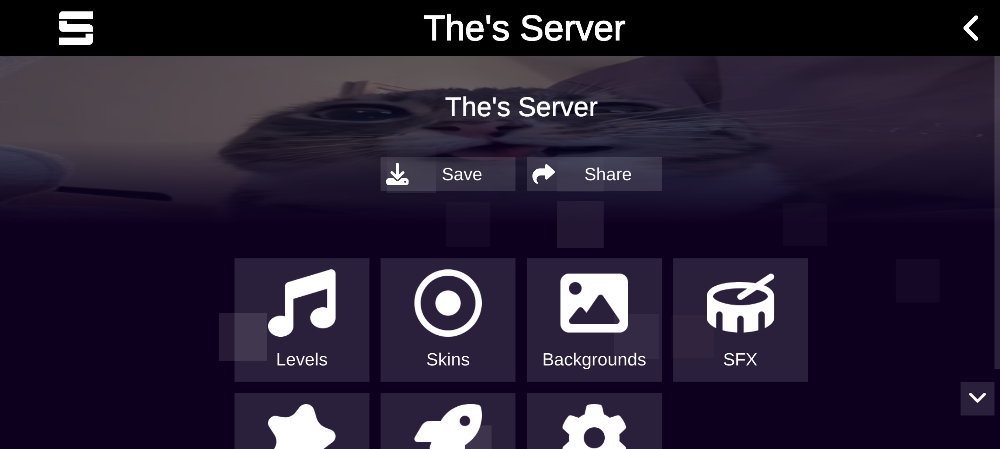

# The's Server

Custom Sonolus server running the NextRUSH+ engine.
Made by the (discord: @blandora2000)

🔗 https://ohdam.vercel.app

## Features
- Cool custom charts, skins, backgrounds, effects, particles
- Auto-generated backgrounds from chart covers
- And more :3

## Tech Stack
- Backend: [@sonolus/express](https://github.com/Sonolus/sonolus-express)
- Frontend: [sonolus-server-web](https://github.com/Sonolus/sonolus-server-web)
- Hosting: Vercel
